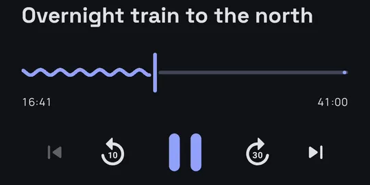
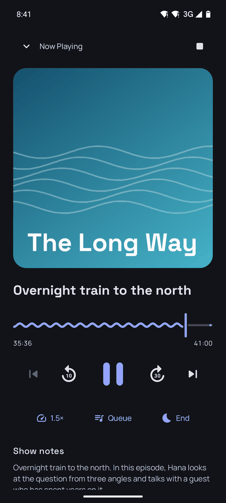
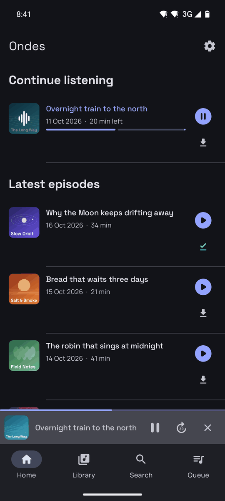
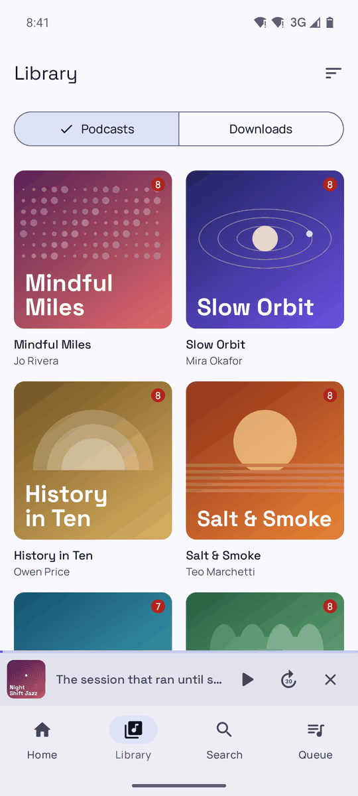
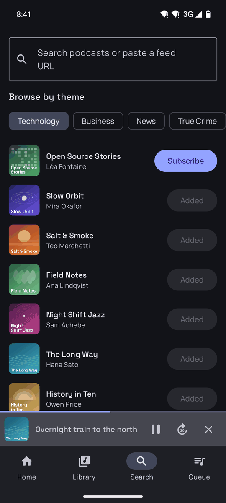
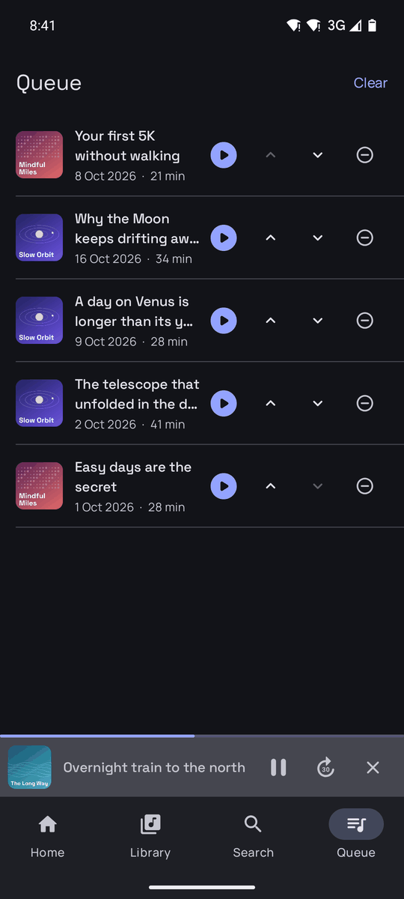
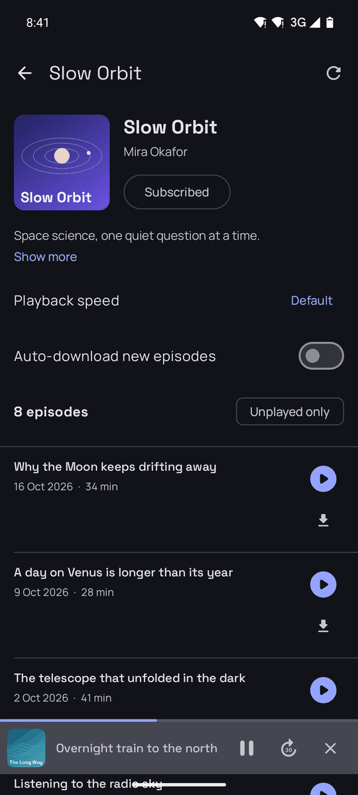
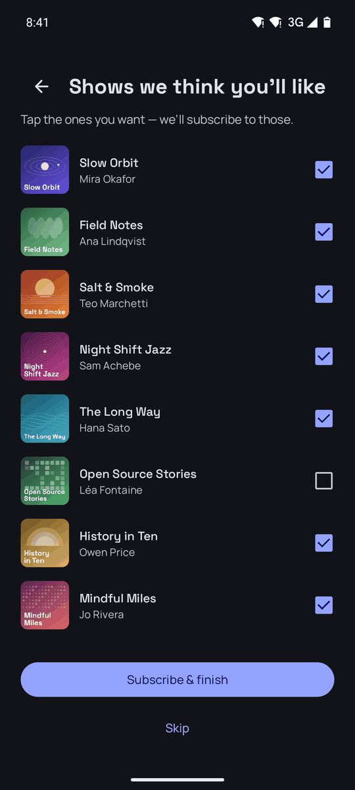
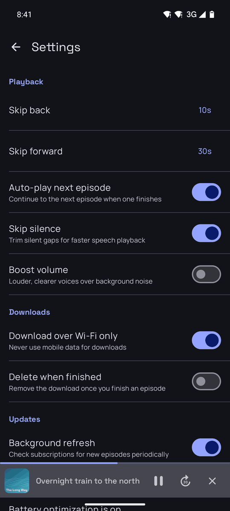

  

<h1 align="center">Ondes</h1>

  A podcast player for Android that leaves you alone. 
  No ads, no trackers, no account. Your shows stay on your phone.

  

  
  

 

<table>
  <tr>
    <td width="45%" align="center"></td>
    <td width="55%">
      <h3>Listen your way</h3>
      
Speed up to 3×, trim the silences, boost quiet voices.

      
Set a sleep timer and drift off at the end of the episode.

    </td>
  </tr>
  <tr>
    <td width="55%">
      <h3>Pick up where you left off</h3>
      
Your place in every episode is saved.

      
Open the app and the next thing to hear is already waiting.

    </td>
    <td width="45%" align="center"></td>
  </tr>
  <tr>
    <td width="45%" align="center"></td>
    <td width="55%">
      <h3>All your shows in one place</h3>
      
Covers front and center, with the count of what you haven't heard yet.

      
Light or dark, it follows your phone.

    </td>
  </tr>
  <tr>
    <td width="55%">
      <h3>Find something new</h3>
      
Browse by theme, search by name, or paste any feed link.

      
One tap to subscribe.

    </td>
    <td width="45%" align="center"></td>
  </tr>
  <tr>
    <td width="45%" align="center"></td>
    <td width="55%">
      <h3>Line up the evening</h3>
      
Play next, add to queue, reorder with a tap.

      
Ondes keeps going from one episode to the next.

    </td>
  </tr>
  <tr>
    <td width="55%">
      <h3>Offline, in the car, everywhere</h3>
      
Download episodes for the train or the plane.

      
Android Auto puts your shows on the dashboard.

    </td>
    <td width="45%" align="center"></td>
  </tr>
</table>

 

  
  

  Your subscriptions, progress and settings never leave the phone. 
  Export them, back them up, take them with you. 
  Available in English, French, German, Spanish and Portuguese.

 

  <a href="https://github.com/Wifsimster/ondes/releases/latest/download/app-release.apk">Download the latest APK</a>
  ·
  <a href="docs/installation.md">Install / contribute</a>

  Ondes means "waves" in French. Podcasts ride the airwaves, your data shouldn't. 
  If you like a player that doesn't spy on you, a star and a word to a friend go a long way.

The shows in these screenshots are made up for the demo.

